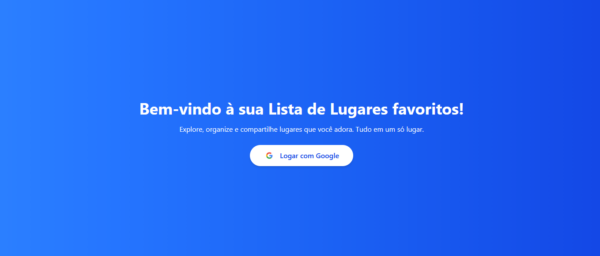

# 🌎 Galeria de Lugares

Uma aplicação web desenvolvida com **Angular** que permite explorar e organizar lugares por meio de uma interface intuitiva e visual.

O projeto foi desenvolvido como parte dos meus estudos em desenvolvimento Front-end, aplicando conceitos de autenticação, proteção de rotas, componentização e estilização moderna.

## Tecnologias utilizadas


## Funcionalidades

- 🔐 **Autenticação social:** login utilizando uma conta Google.
- 🛡️ **Proteção de rotas:** utilização de Angular Guards para controlar o acesso às páginas.
- 🖼️ **Galeria de lugares:** visualização dos lugares cadastrados.
- 🗂️ **Categorias:** organização e visualização de categorias.
- 🧭 **Navegação:** navegação entre as diferentes páginas da aplicação.

## Demonstração

### Login



### Galeria


### Categorias


### Lugares


## 🚀 Como executar o projeto

### 1. Clone o repositório

```bash
git clone https://github.com/ductvi/Galeria-de-lugares-Angular.git
```

### 2. Acesse a pasta do projeto

```bash
cd Galeria-de-lugares-Angular
```

### 3. Instale as dependências

```bash
npm install
```

### 4. Execute a aplicação

```bash
npx ng serve
```

### 5. Acesse no navegador

```text
http://localhost:4200
```

A aplicação estará disponível em ambiente de desenvolvimento.

## Conhecimentos aplicados

- Desenvolvimento de aplicações com Angular.
- Criação e reutilização de componentes.
- Estilização de interfaces com Tailwind CSS.
- Integração de autenticação social com Google.
- Implementação de Guards para proteção de rotas.
- Organização e estruturação de projetos Front-end.
- Utilização de TypeScript e SCSS.

## Autor

**Eduardo Custódio**

[](https://github.com/ductvi)

